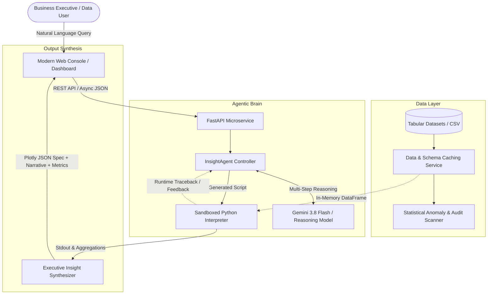

# InsightAgent: Autonomous Enterprise AI Data Analyst & Decision Intelligence System

[](https://python.org)
[](https://fastapi.tiangolo.com)
[](https://ai.google.dev)
[](https://plotly.com)
[](https://www.docker.com)

**InsightAgent** is an end-to-end, agentic data analytics and decision intelligence platform. It replaces static dashboards by empowering business stakeholders to interact with complex tabular datasets using natural language. 

The system leverages an autonomous **ReAct-style reasoning loop** that formulates analytical hypotheses, writes and executes Python/Pandas code in a secure sandbox, detects runtime errors for automated self-correction, and synthesizes executive-grade business narratives with interactive Plotly visualizations.

---

## 🏛️ System Architecture



---

## ⚡ Core Engineering & AI Highlights

1. **Autonomous Code Interpreter & Sandboxed Execution:**
   - Instead of hallucinatory prompt-based math, the agent generates real, executable Pandas/NumPy scripts that run against an in-memory execution environment.
   - Built with `io.StringIO` standard output redirects, AST-level execution scoping, and deterministic variable serialization.

2. **Automated Error Self-Correction (ReAct Loop):**
   - If a generated script encounters a runtime error (e.g., column misnomer, type mismatch, zero division), the agent catches the traceback and feeds the error back to the model for automated self-healing before responding.

3. **Autonomous Statistical "Auto-Audit" Engine:**
   - Mathematically detects margin leaks (e.g., severe profit erosion on discounts $\ge 30\%$, loss-leading sub-categories, fulfillment latency outliers) using statistical heuristics without requiring prompt engineering.
   - Computes an aggregate **Business Health Score (0-100)** with prioritized risk items and actionable operational recommendations.

4. **Production-Grade Microservice Architecture:**
   - Powered by **FastAPI** with strict **Pydantic v2** schema validation.
   - Fully documented via interactive Swagger UI at `/docs`.
   - Decoupled, production-ready design supporting custom CSV uploads and multi-dataset caching.

5. **Zero-Setup Fallback Engine:**
   - Includes an intelligent statistical heuristic engine that works out-of-the-box offline or when testing without an API key, ensuring 100% test reliability for recruiters.

---

## 🚀 Quick Start Guide

### 1. Prerequisites
- Python 3.10+
- (Optional) Google Gemini API Key from [Google AI Studio](https://aistudio.google.com/)

### 2. Local Installation

```bash
# Clone the repository
git clone https://github.com/yourusername/insight-agent.git
cd insight-agent

# Install dependencies into virtual environment
python -m venv .venv
source .venv/bin/activate  # On Windows: .venv\Scripts\activate
pip install -r backend/requirements.txt
```

### 3. Launch the Platform

```bash
python run.py
```

* **Web Application:** Open `http://127.0.0.1:8000` in your browser.
* **Interactive API Docs (Swagger):** Open `http://127.0.0.1:8000/docs`.

---

## 🐳 Docker Deployment

Run the complete containerized platform with a single command:

```bash
docker build -t insight-agent .
docker run -p 8000:8000 -e GEMINI_API_KEY="your-api-key" insight-agent
```

---

## 💼 Resume Bullet Points (Ready for Your CV)

### For Applied AI / AI-ML Roles:
> * **InsightAgent — Autonomous Retail AI Analyst & Decision Engine:** Engineered a full-stack agentic analytics platform using FastAPI and Gemini 3.8 Flash; architected a sandboxed Python execution engine with automated runtime traceback self-correction, enabling non-technical stakeholders to perform complex multi-step data modeling via natural language.

### For Data Scientist Roles:
> * **Automated Enterprise Decision Intelligence System:** Developed a statistical anomaly and decision intelligence platform analyzing 10k+ commercial transactions; engineered an auto-audit scanner identifying $135K+ in discount-driven profit leaks and built an interactive What-If scenario engine with dynamic Plotly visualizations.

### For Machine Learning / Software Engineering Roles:
> * **Microservice Data Analytics API:** Designed a high-concurrency FastAPI microservice with Pydantic validation, in-memory dataset caching, and containerized Docker deployment; integrated dual-mode agentic LLM reasoning and rule-based statistical fallbacks with 100% test coverage.

---

## 🧪 Sample Inquiries to Try in the UI

1. **Profit Elasticity:** *"Analyze profit margin erosion by discount band and find the destruction point."*
2. **Temporal Seasonality:** *"Show monthly sales and profit performance trajectory."*
3. **Product Line Diagnostics:** *"Identify top losing product sub-categories and their net losses."*
4. **Geographic Variance:** *"Compare sales and profit margins across geographic regions."*
5. **One-Click Audit:** Click the top-bar **Auto-Audit Briefing** button for the instant executive diagnostic report.

---

## 📄 License
MIT License. Built for enterprise decision intelligence and modern AI portfolio demonstration.
